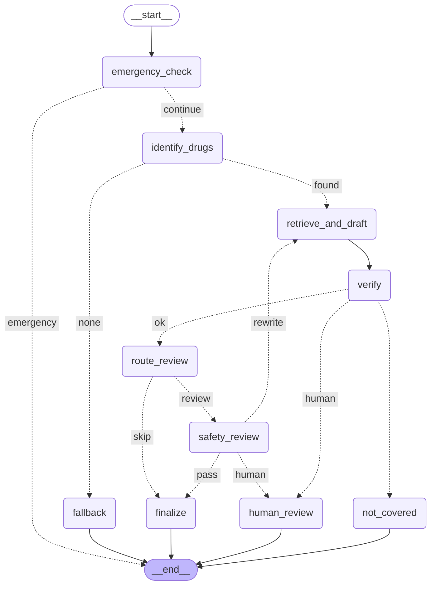

# MedInfo Agent

**MedInfo Agent** answers questions about over-the-counter and prescription drugs using only official FDA drug labels (via openFDA), with every answer citing the label sections it came from. It reports what the label says and never gives personal medical advice. Currently it covers ibuprofen and naproxen.

Safety is enforced in code, not just in the prompt: a LangGraph state machine decides every step, so a user can't talk the system out of its rules. Emergencies are short-circuited before any model call, answers are checked for invented numbers and unknown sources, risky questions get a second-model safety review, and anything uncertain goes to a human reviewer.

**Tech stack:** LangGraph · LangChain · Gemini 3.5 Flash Lite · Chroma · LangSmith · FastAPI · Docker · Azure Container Apps

> This is a portfolio project for learning and demonstration. It is not a medical device and must not be used for medical decisions.

---

## Architecture

The diagram is generated from the code (`app.get_graph().draw_mermaid()`), so it always matches the graph that runs. Solid arrows are fixed edges; dotted arrows are decisions made by router functions.



| Node | What it does | Model call? |
|---|---|---|
| `emergency_check` | Detects overdose/poisoning phrasing (including a child word plus an ingestion phrase) and ends the run with emergency-contact advice | No |
| `identify_drugs` | Finds supported drug names in the question; unsupported drugs go to `fallback` | No |
| `fallback` | Lists the supported drugs and adds an emergency line | No |
| `retrieve_and_draft` | Per-drug filtered vector search (k=3, distance cutoff 0.7), then a structured answer (`answerable`, `answer`, `sources`) grounded in the tagged excerpts | Yes (embedding + chat) |
| `verify` | Deterministic checks on the draft: sources present, sources actually retrieved, no numbers absent from the label or question, no banned phrases | No |
| `not_covered` | Returned when the model marks the question unanswerable from the label | No |
| `route_review` | Pass-through node; its router (`needs_review`) sends dosing, amount, pregnancy, child and combination questions, or any question containing a number, to review | No |
| `safety_review` | Second model checks for omitted warnings, personal advice and contradictions; one rewrite with its feedback, then human review | Yes (chat) |
| `human_review` | Pauses the graph with `interrupt()`; a reviewer approves, edits or rejects, and the run resumes from the same point | No |
| `finalize` | Returns the answer, adding a caveat when excerpts come from different label types (OTC vs prescription) | No |

### Data and retrieval

- **Source:** openFDA drug label API (`/drug/label.json`), searched by generic name.
- **Indexing (`rag.py`):** selected label sections (indications, dosage, warnings, boxed warning, contraindications, interactions, specific populations and others) are split into 1,000-character chunks with 200-character overlap. Each chunk carries metadata: drug, section, label type (OTC or Rx) and source ID.
- **Startup check:** indexing fails if a label has none of the core safety sections, so a label with missing warnings can't silently enter the index.
- **Store:** Chroma, persisted to `chroma_db/` and built once. The supported-drug allow-list is derived from the index itself, so it can't claim drugs that were never indexed.
- **Embeddings:** `gemini-embedding-001`.

### Model access (`llm.py`)

All chat calls share one model object with a token-bucket rate limiter (0.2 requests/second, no bursts) and `max_retries=3`, so the drafter, the safety reviewer and the eval judge stay under the free-tier per-minute quota together.

---

## Safety design

In the order a question passes through them:

1. **Emergency short-circuit:** overdose and poisoning questions (including a child plus an ingestion phrase) never reach the model; the user gets emergency-contact advice immediately.
2. **Drug allow-list:** questions about drugs outside the indexed set are refused before retrieval, so the model never sees them.
3. **Grounded retrieval:** retrieval is filtered per drug, preventing cross-drug leaks, and excerpts beyond a distance cutoff are dropped. The model may answer only from the remaining excerpts and must cite them.
4. **"Not covered" path:** if nothing relevant is retrieved, or the model marks the question unanswerable, the user is told the label doesn't cover it, rather than given a guess.
5. **Code verification (`verify`):** deterministic checks on every draft: sources present, sources actually retrieved, no numbers absent from the label or question, no banned phrases. Any failure goes to human review.
6. **Safety reviewer:** for risky questions (doses, amounts, pregnancy, children, combinations), a second model checks for omitted warnings, personal advice and contradictions. A failed draft gets one rewrite with the reviewer's feedback; a second failure goes to human review.
7. **Human review:** the graph pauses (`interrupt`) with the draft and the reasons it was flagged; a reviewer approves, edits or rejects it, and the run resumes from the same point.

Design principle: **cheap code checks first, model judgement only where code can't decide.** Answers are phrased as what the label says ("No, the label says not to exceed…"), never as personal advice.

---

## Evaluation

Run all cases, or a single case by ID:

```bash
python evals.py
python evals.py dose_overlimit
```

**Eval set:** 13 cases across 7 categories: answerable (4), emergency (2), out of scope (2), prompt injection (2), comparison (1), child dosing (1) and label gap (1). Each case runs 3 times to catch non-deterministic failures.

Each case can check:

- `expected_route`: a list of acceptable routes (for example `["answer", "human"]`, since escalating to a human is also safe),
- `must_include` / `must_include_any` / `must_not_include`: phrase checks on the reply (case-insensitive; `must_include_any` accepts several valid wordings),
- **LLM judge** (answered routes only): a separate structured-output call grades whether the reply answers the question, agrees with an unsafe claim, and is supported by the retrieved excerpts.

Failures print exactly what went wrong (missing phrase, forbidden phrase, wrong route, or the judge's reason) together with the reply.

**Testing the testers:**

- `test_verify()` checks the code verifier on a good draft, an invented number and an unknown source.
- `test_judge()` checks the judge on five hand-labelled replies (good, unsafe, unsupported, injected, and a correctly refused injection). Verdicts were stable across repeated runs.
- `test_safety_review()` checks the reviewer on good, missing-limit and personal-advice drafts, and again with a different label limit to confirm it reads the label rather than copying the prompt's example.

**Lessons recorded during development:** several failures were wrong tests, not wrong answers (a numeric check flagging the user's own "8 year old", phrase checks missing valid paraphrases, a judge marking a correct refusal as unhelpful). Each was fixed in the test, and the fix was itself tested.

---

## Observability

- **LangSmith tracing** records every node, prompt, model call, token count and latency. Set `LANGSMITH_TRACING=true`, `LANGSMITH_API_KEY` and `LANGSMITH_PROJECT` in `.env`.
- **Version tagging:** the Docker build receives the git commit (`--build-arg GIT_SHA=...`), and every API request attaches it to its trace as `app_version`, so any trace can be traced back to the exact code that produced it.
- **Latency investigation:** the deployed app showed 20–30 s responses. Tracing and targeted tests ruled out cold starts (same warm container), the rate limiter (adds at most 5 s) and hidden retries (`httpx` logs showed one `200 OK` request per call). Direct calls to the model with no app involved took 11–24 s, confirming free-tier model latency as the cause.

---

## Running it

### Local

Requires Python 3.12.

```bash
python3.12 -m venv .venv
source .venv/bin/activate
pip install -r requirements.txt
```

Create `.env` (never commit it):

```
GOOGLE_API_KEY=...
LANGSMITH_TRACING=true
LANGSMITH_API_KEY=...
LANGSMITH_PROJECT=medinfo-agent
```

The first import of `rag.py` builds the Chroma index if `chroma_db/` is empty. Delete `chroma_db/` to rebuild after changing sections or chunk size.

Start the API and open the Swagger UI at `http://127.0.0.1:8000/docs`:

```bash
uvicorn api:api --reload
```

### API

| Endpoint | Body | Returns |
|---|---|---|
| `POST /ask` | `{"question": "...", "thread_id": "optional"}` | `status` (`answered` or `pending_review`), `route` (`answer`, `emergency`, `fallback`, `not_covered`), `thread_id`, `reply` |
| `POST /review/{thread_id}` | `{"approved": true, "text": "optional edited answer"}` | the resumed run's reply |
| `GET /health` | | `{"status": "ok"}` |

### Docker

```bash
docker build -t medinfo-agent .
docker run -p 8080:8080 --env-file .env medinfo-agent
```

Keys are passed at run time and never baked into the image (`.env`, `.venv/` and `.git/` are in `.dockerignore`). The prebuilt `chroma_db/` is included so containers start without re-embedding. Dependencies are installed before the code is copied, so code-only changes rebuild in seconds.

### Cloud deployment (Azure Container Apps)

```bash
docker buildx build --platform linux/amd64 \
  --build-arg GIT_SHA=$(git describe --always --dirty) \
  -t <registry>.azurecr.io/medinfo-agent:v2 --push .
```

The image was pulled from Azure Container Registry using a managed identity. API keys were stored as Container Apps secrets and exposed as environment variables. Scaling was set to 0–1 replicas to cap cost (accepting a cold start) and target port 8080. The same image runs on Google Cloud Run, with Artifact Registry and Secret Manager playing the equivalent roles.

---

## Limitations and next steps

1. **Two drugs, generic names only.** "Advil" isn't recognised as ibuprofen. Next: index more labels, add brand-name mapping, and add eval cases per drug.
2. **No authentication.** Anyone with the URL can query the API or approve a paused answer via `/review`. Next: API keys or OAuth, with reviewer-only access to `/review`.
3. **In-memory checkpoints.** Paused reviews are lost on restart and aren't shared across instances. Next: `PostgresSaver` on managed Postgres.
4. **No reviewer interface.** Reviewers must call the API directly and can't see pending items. Next: a review queue UI (for example in Retool).
5. **Latency.** Free-tier model calls took 11–24 s each in testing (P50 about 20–33 s per request). Next: paid tier, per-call timeouts with a fallback, streaming responses.
6. **Evaluation depth.** 13 cases, partly phrase-based. The LLM judge covers paraphrases but is the same model it grades. Next: more cases, a stronger judge model, and LangSmith datasets for experiment comparison.
